# Platform Infrastructure

## Argo CD bootstrap

The `platform-infra` AppProject must exist before applying `platform-root`, because
the root application belongs to that project. Bootstrap it once, then Argo CD keeps
the project reconciled from `argocd/apps/project.yml` alongside all child applications.

```bash
kubectl apply -f argocd/namespace.yml
kubectl apply -f argocd/apps/project.yml
kubectl apply -f argocd/root-app.yml
```

### Argo CD Live Status

<div align="center">

| Application | Status |
| --- | --- |
| [platform-root](https://argocd.nzhussup.dev/applications/platform-root) |  |
| [services](https://argocd.nzhussup.dev/applications/services) |  |
| [gateway](https://argocd.nzhussup.dev/applications/gateway) |  |
| [envoy-gateway-controller](https://argocd.nzhussup.dev/applications/envoy-gateway-controller) |  |
| [config](https://argocd.nzhussup.dev/applications/config) |  |
| [https-encryption](https://argocd.nzhussup.dev/applications/https-encryption) |  |
| [persistence](https://argocd.nzhussup.dev/applications/persistence) |  |

</div>

[](https://kubernetes.io/)
[](https://k3s.io/)
[](https://www.docker.com/)
[](https://argo-cd.readthedocs.io/)
[](https://www.keycloak.org/)
[](https://redis.io/)
[](https://gateway.envoyproxy.io/)
[](https://letsencrypt.org/)
[](https://github.com/features/actions)
[](https://www.gnu.org/software/bash/)

## Overview

This repository contains the infrastructure configuration for running the `nzhussup.dev` platform and related internal services. Its main purpose is to keep deployment configuration, ingress rules, TLS setup, persistence definitions, and local infrastructure helpers in one place.

The repository is operational in scope. It does not contain application business logic. Instead, it defines how services are exposed, secured, persisted, and started in the target environment.

Current routing model:

- public/frontend hosts can use both `.dev` and `.com`
- backend API and Keycloak auth are exposed only on `.dev`

## Architecture

This single diagram combines public traffic, the web and API services, platform websites, and each service dependency. Dashed boundaries group services by responsibility; arrows show routes and dependency use. The canonical source is [docs/architecture.mmd](./docs/architecture.mmd).

```mermaid
%%{init: {"theme":"base", "themeVariables":{"fontFamily":"Inter, Segoe UI, Arial, sans-serif", "primaryColor":"#f5f8fb", "primaryTextColor":"#172536", "primaryBorderColor":"#8b9aab", "lineColor":"#53657a", "tertiaryColor":"#f7f9fb"}, "flowchart":{"curve":"stepAfter", "nodeSpacing":48, "rankSpacing":64}}}%%
flowchart TB
  visitors["USERS & API CLIENTS<br/>Browser · HTTPS"] --> gateway["EDGE · TLS<br/>Envoy Gateway<br/>Gateway API · routes · policies"]

  subgraph cluster["KUBERNETES CLUSTER · ARGO CD MANAGED"]
    direction TB

    subgraph web["WEB APPLICATIONS"]
      direction TB
      web_routes["HTTPRoute · web hosts"]
      portfolio["Web Portfolio<br/>nzhussup.dev · :8000"]
      admin["Web Admin Panel<br/>admin.nzhussup.dev · :8020"]
      web_routes --> portfolio
      web_routes --> admin
    end

    subgraph api["BACKEND API · api.nzhussup.dev"]
      direction TB
      api_routes["HTTPRoute · API paths"]

      subgraph base_row["BASE SERVICE"]
        direction LR
        base["Base Service<br/>/v1/base · :8010"] --> base_dependencies["Redis<br/>PostgreSQL<br/>GitHub API"]
      end
      subgraph image_row["IMAGE SERVICE"]
        direction LR
        image["Image Service<br/>/v1/album · :8085"] --> image_dependencies["Redis · shared cache<br/>Image PV"]
      end
      subgraph llm_row["LLM SERVICE"]
        direction LR
        llm["LLM Service<br/>/v1/llm · :8086"] --> llm_dependencies["Configured LLM provider"]
      end
      subgraph account_row["ACCOUNT SERVICE"]
        direction LR
        account["Account Service<br/>/v1/account · :8087"] --> account_dependencies["Keycloak"]
      end

      api_routes --> base
      api_routes --> image
      api_routes --> llm
      api_routes --> account
    end

    subgraph platform["IDENTITY · OPERATIONS · SHARED SERVICES"]
      direction TB
      ops_routes["HTTPRoute · platform websites"]
      subgraph keycloak_row["IDENTITY"]
        direction LR
        keycloak["Keycloak<br/>auth.nzhussup.dev · :8080"] --> keycloak_dependencies["PostgreSQL"]
      end
      api_docs["API Docs<br/>/docs · :8080"]
      argocd["Argo CD<br/>argocd.nzhussup.dev"]
      monitoring["Monitoring<br/>monitoring.nzhussup.dev"]
      ops_routes --> keycloak
      ops_routes --> api_docs
      ops_routes --> argocd
      ops_routes --> monitoring
    end

    gateway --> web_routes
    gateway --> api_routes
    gateway --> ops_routes

  end

  classDef ingress fill:#eaf2ff,stroke:#3977ad,stroke-width:2px,color:#102a43
  classDef route fill:#f2f6fa,stroke:#8094a8,stroke-dasharray:4 3,color:#34465a
  classDef webNode fill:#f1f7fc,stroke:#5790be,color:#17324d
  classDef backendNode fill:#edf7f4,stroke:#4c9185,color:#173d38
  classDef platformNode fill:#ffffff,stroke:#9aa9b8,color:#233243
  classDef opsNode fill:#f1f7fc,stroke:#5790be,color:#17324d
  classDef dependencyNode fill:#f8fafc,stroke:#a4b1bf,color:#34465a
  class visitors,gateway ingress
  class web_routes,api_routes,ops_routes route
  class portfolio,admin webNode
  class base,image,llm,account backendNode
  class keycloak,api_docs platformNode
  class argocd,monitoring opsNode
  class base_dependencies,image_dependencies,llm_dependencies,account_dependencies,keycloak_dependencies dependencyNode
  linkStyle default stroke:#53657a,stroke-width:1.6px
```



See [the architecture notes](./docs/architecture.md) for scope and configuration details.

## Purpose

The project serves as the infrastructure layer for the wider platform. It is used to:

- manage Kubernetes manifests for deployed services
- configure Gateway API resources and external routing
- handle HTTPS termination and certificate issuance
- define persistent storage used by stateful workloads
- document operational setup steps that are not part of application repositories

## Technology Scope

The repository currently centers on:

- Kubernetes manifests for runtime configuration
- k3s-compatible deployment structure
- Envoy Gateway and Kubernetes Gateway API
- Let's Encrypt and cert-manager based TLS setup
- Argo CD GitOps application orchestration
- shell scripts for local and server-side operational tasks
- GitHub Actions for release automation

## Repository Structure

```text
.
├── k8s/
│   ├── services/              # Service and deployment manifests
│   ├── gateway/              # Gateway API routes and traffic policies
│   ├── https-encryption/     # TLS and certificate configuration
│   ├── persistence/          # Persistent volume definitions
│   └── discontinued-services/# Archived or no longer active manifests
├── docs/                     # Supporting operational documentation
├── scripts/                  # Utility and maintenance scripts
└── .github/workflows/        # Release workflow automation
```

## Main Areas

### Kubernetes Manifests

The `k8s/` directory contains the deployment-related resources used on the target cluster. This includes Gateway API resources, TLS configuration, persistence definitions, and service-specific manifests.

Infrastructure runtimes such as Redis are also defined here at manifest level instead of being built as custom application images.

Keycloak is deployed as its own service for platform IAM, while the realm template and startup logic live in the backend repository.

### Operational Scripts

The `scripts/` directory contains helper scripts for environment setup and maintenance tasks. These scripts are operational utilities and should be reviewed before execution in any non-local environment.

### Documentation

The `docs/` directory contains supporting setup notes, for example database-related operational guidance in [docs/db-setup.md](./docs/db-setup.md).

## Requirements

To use this repository effectively, the following tools or environments are expected:

- a Kubernetes cluster
- a k3s-compatible target environment if you want to mirror the current production approach
- `kubectl` access to the cluster
- Docker for local container-based development workflows

## Services

| Service           | Role                                           | Main Location                                                          |
| ----------------- | ---------------------------------------------- | ---------------------------------------------------------------------- |
| `Envoy Gateway`   | External routing, authentication, and policies  | `k8s/gateway/`                                                         |
| `Let's Encrypt`   | TLS issuer and certificate automation          | `k8s/https-encryption/`                                                |
| `Redis`           | Shared cache/runtime dependency                | `k8s/services/backend-services/backend-redis-server-deployment.yml`    |
| `Keycloak`        | IAM, realm import, and auth runtime            | `k8s/services/backend-services/backend-keycloak-server-deployment.yml` |
| `API Docs`        | Static unified Swagger UI                     | `k8s/services/backend-services/backend-api-docs-deployment.yml`        |
| `Base Service`    | Core application backend service               | `k8s/services/backend-services/backend-base-service-deployment.yml`    |
| `Image Service`   | Backend image/media service                    | `k8s/services/backend-services/backend-image-service-deployment.yml`   |
| `LLM Service`     | Backend LLM integration service                | `k8s/services/backend-services/backend-llm-service-deployment.yml`     |
| `Account Service` | Authenticated self-service account operations  | `k8s/services/backend-services/backend-account-service-deployment.yml` |
| `Web Admin Panel` | Admin frontend runtime                         | `k8s/services/web-admin-panel/`                                        |
| `Web Portfolio`   | Public frontend runtime                        | `k8s/services/web-portfolio/`                                          |

## Release and Versioning

This repository also contains release automation and changelog support. Versioning and tagged release handling are managed through the workflow configuration in `.github/workflows/` and the release scripts stored in `.github/scripts/`.
